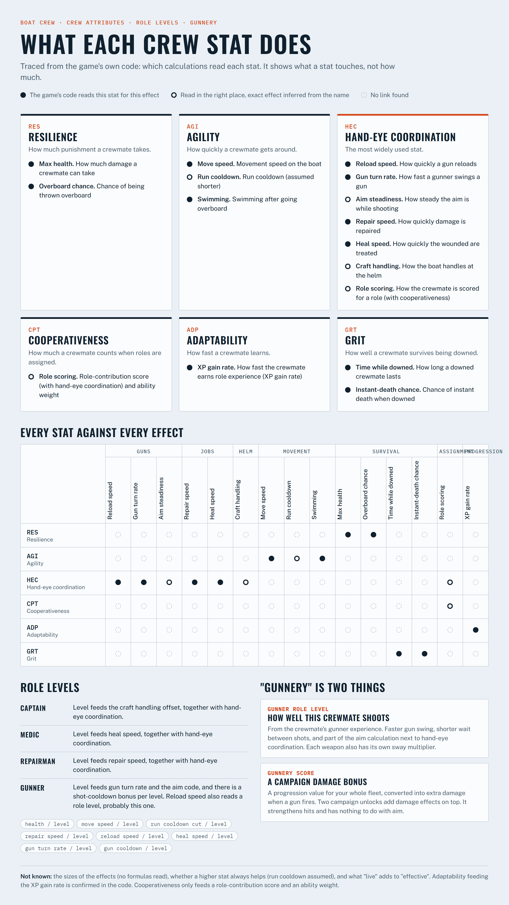

# What the crew stats do

Every crewmate in Boat Crew has six attributes (RES, AGI, HEC, CPT, ADP, GRT) and a level in each of four roles. The game never says what they change. This is what its code uses each one for, found by tracing which calculations read each stat, plus the game's real constants read from the running game by the mod. It tells you what a stat touches and the per-level amounts; the exact formulas were not decompiled.

The same content as an interactive page: [docs/index.html](../docs/index.html).

## The six attributes

Each attribute has a raw value (around 50), a trait adjustment, an "effective" value and a "live" value, which is what most calculations read. From a logged crewmate, **effective = raw − 50** (raw 54 agility gave effective 4; raw 42 resilience gave −8) and live equalled effective, with trait 0. `statGlobalScaleY` = 0.01 is probably what turns one effective point into a 1% change, but that is a guess.

| Stat | What the code reads it for | Certainty |
| --- | --- | --- |
| **RES** Resilience | Max health; chance of being thrown overboard; the hit reaction | read for these |
| **AGI** Agility | Movement speed; run cooldown; swimming after going overboard | run cooldown's direction is assumed |
| **HEC** Hand-eye coordination | Reload speed; repair speed; heal speed; gun turn rate; aim steadiness (read inside the gun mount's recoil and sway code); craft handling at the helm; role scoring | aim and helm effects inferred from where it is read |
| **CPT** Cooperativeness | Role scoring: a role-contribution score (with HEC) and an ability-score weight | effect on play not visible |
| **ADP** Adaptability | **XP gain rate.** `ExperienceGainRate` reads raw adaptability and `baseExperienceGainRate`, and no other attribute | read for this |
| **GRT** Grit | Chance of instant death when downed; how long a downed crewmate lasts | read for these |

Reload, repair and heal speed and the gun turn rate also scale with the crewmate's role level (gunner, repairman, medic, captain respectively).

## The game's numbers

Static fields of `Core.CharacterConstants`, read from the running game (October 2026 build):

| Constant | Value |
| --- | --- |
| health base / per level / per increment | 200 / +20 / 50 |
| move speed base / per level | 0.75 / +0.05 |
| run cooldown / decrement per level | 10 s / −0.5 s |
| repair speed base / per level | 1.0 / +0.15 |
| reload speed base / per level | 1.0 / +0.10 |
| heal speed base / per level | 1.0 / +0.20 |
| gunner turn rate base / per level | 1.2 / +0.15 |
| gunner cooldown per level | 0.05 |
| XP per action: repair with item / without, heal with item / without, give ammo | 10 / 2, 10 / 2, 3 |
| level XP: base / power | 10 / 0.5 |
| base experience gain rate | 1 |
| base allowed downed time | 30 s |
| grit above average for zero instant-death chance / instant-death chance by low grit | 10 / 0.5 |
| overboard chance | 0.02 |
| weight base | 70 |
| base ability score weight | 100 |

How an attribute's effective points combine with these per-level amounts (added or multiplied) was not read.

## "Gunnery" is two things

- **The gunner role level** is the crewmate's own experience as a gunner. It speeds up how fast they swing a gun, shortens the wait between shots (`gunnerCooldownPerLevel`), and goes into the gun's aim code next to hand-eye coordination. Each weapon also has its own `gunnerSwayMultiplier`, so how steady a shot is depends on the crewmate and on the gun.
- **The campaign gunnery score** is a progression value for the whole fleet. `GunMount` converts it into extra damage when a gun fires (`entityGunneryScoreToDamage`), and two campaign unlocks add damage effects on top. It makes hits stronger and has nothing to do with aim.

## How this was found

1. Dump the game's class layout with [Il2CppInspectorRedux](https://github.com/LukeFZ/Il2CppInspectorRedux) (the Legacy CLI reads this game's IL2CPP metadata v39): every method with its address, every field with its offset.
2. Run [callers.py](callers.py): it scans the compiled code for direct calls to each attribute getter and names the calling method from the dump. Example: nine calculations call `get_Attribute_Live_HANDEYECOORDINATION`, including `repairSpeedValue`, `reloadSpeedValue`, `gunnerTurnRateValue` and `GunMount.handEyeCoordination`.
3. Check for direct field reads too. `ExperienceGainRate` never calls the adaptability getter; it reads the raw field (offset 0x8C) directly, which the first pass missed. Searching for the field offsets turned it up.
4. Read the constants live: the mod logs `CharacterConstants` and the possessed crewmate's raw/trait/effective/live values to `BoatCrewMod/mod.log`.

Blind spots: virtual or delegate calls, fields read without their getter (checked only for the six attributes), and the lack of formulas. Adaptability was reported as unused until step 3.
